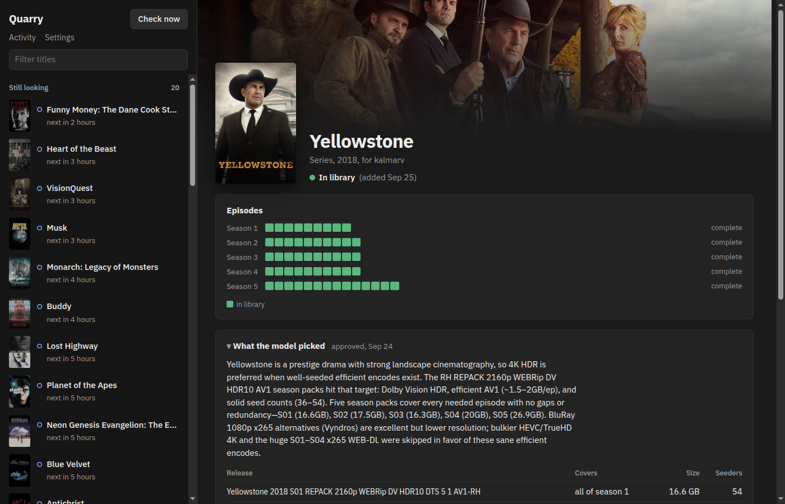

# Quarry

Quarry downloads what people request in [Seerr](https://github.com/seerr-team/seerr).
It replaces Radarr and Sonarr with an LLM that reads release names. It searches
your indexers through Prowlarr, picks releases that fit a plain-English quality
policy, downloads them with qBittorrent, and files them into your Jellyfin
library.



## How it works

- Everything with a right answer is plain code: identity, naming, paths and
  state. The model only picks releases and says which file is which episode.
- Every two minutes Quarry compares what's wanted with what qBittorrent, the
  disk and Jellyfin report, and takes the next step. All state lives in SQLite,
  so restarts lose nothing.
- Torrents are tracked by infohash. Files are hardlinked into the library after
  ffprobe accepts them.
- Episodes and films wait until they're actually out (air date, or a digital or
  physical release).
- Plans run automatically, or wait for you to approve them in the UI.

[PLAN.md](PLAN.md) has the full design.

## Getting started

You need Docker and an [OpenRouter](https://openrouter.ai/) API key. Downloads
and the library must be on the same filesystem, so hardlinks work.

### 1. Set up the other services

- **qBittorrent 5.2+.** Turn on the Web UI (Tools → Options → Web UI) and set a
  username and password. Quarry adds torrents under the category `quarry`.
- **Prowlarr.** Add your indexers. The API key is under Settings → General.
- **Jellyfin.** Create one library for movies and one for TV. Create an API key
  under Dashboard → API Keys.
- **Seerr 3.x.** Connect it to Jellyfin as usual. The API key is under
  Settings → General. Step 3 connects it to Quarry.

### 2. Configure and run Quarry

```sh
cp .env.example .env   # then fill it in
docker compose up -d --build
```

| Variable | What to put |
|---|---|
| `SEERR_URL`, `SEERR_API_KEY` | Seerr address and API key |
| `PROWLARR_URL`, `PROWLARR_API_KEY` | Prowlarr address and API key |
| `QBIT_URL`, `QBIT_USERNAME`, `QBIT_PASSWORD` | qBittorrent Web UI address and login |
| `JELLYFIN_URL`, `JELLYFIN_API_KEY` | Jellyfin address and API key |
| `OPENROUTER_API_KEY` | Your OpenRouter key |
| `MEDIA_ROOT` | Host folder that contains both downloads and library |
| `LIBRARY_MOVIES`, `LIBRARY_TV` | Your Jellyfin library folders |
| `DOWNLOADS_PATH` | qBittorrent's download folder, as a host path |
| `QBIT_PATH_PREFIX` | The same folder as qBittorrent sees it, if it runs in a container (default `/downloads`) |

The UI is at `http://<host>:3004`.

### 3. Point Seerr at Quarry

In Seerr, go to Settings → Services. Add a Radarr server and a Sonarr server,
both with Quarry's host, port `3004` and any API key. Choose the "Default"
profile and the root folder offered. Approved requests now show up in Quarry
within two minutes.

### 4. Check the settings

In Quarry's Settings you can edit the quality policy, the models, approval mode
and Letterboxd picks. Out of the box, plans are approved automatically and
films trending on Letterboxd are requested. Turn either off if you don't want
that.

> Quarry has no login. Keep it on your own network or behind a reverse proxy
> that handles authentication.

## Development

```sh
bun install && (cd ui && bun install)
bun test && bun run typecheck
bun --env-file=.env run src/index.ts   # API on :3000
(cd ui && bun run dev)                 # UI with hot reload
```

## License

[MIT](LICENSE)
